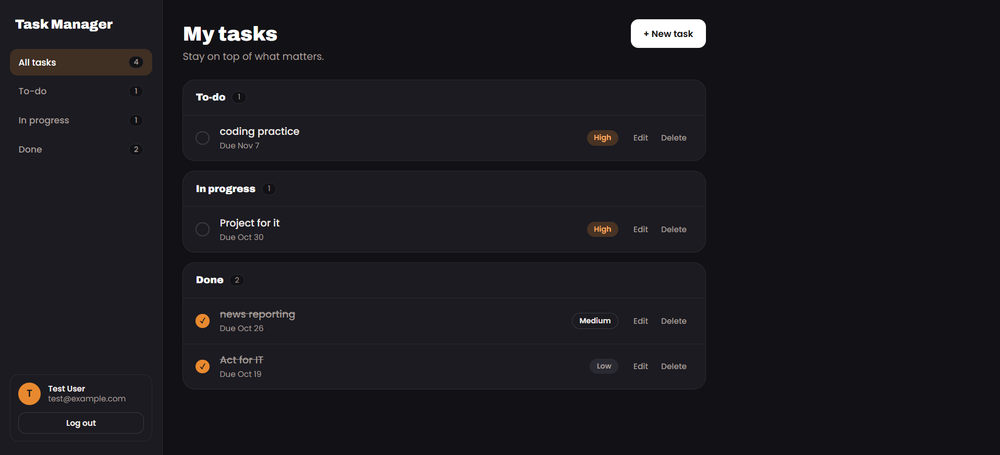

# Task Manager

A full stack task manager with user accounts, secure login, and a real PostgreSQL database. People register, log in, and manage their own tasks: create, edit, tick off, delete, and filter by status. Built as a portfolio project to practice SQL, authentication, and REST API design.

**Live demo:** _coming soon_



## Features

- Register and log in with email and password
- Passwords are hashed with bcrypt, never stored as plain text
- JWT-based sessions (the login lasts 7 days)
- Private tasks: every user only sees and edits their own
- Create, edit, delete, and mark tasks as done
- Tasks are grouped by status (To-do, In progress, Done) with live counts
- Priority pills (low, medium, high) and due dates with an overdue marker
- Filter tasks by status from the sidebar
- Mobile friendly layout, with light and dark mode that follows your device
- Friendly error messages and a "waking up the server" notice for free hosting

## Built with

- **Backend:** Node.js, Express 5
- **Database:** PostgreSQL on Neon (free tier), using the `pg` driver
- **Auth:** `bcryptjs` for password hashing, `jsonwebtoken` for JWT
- **Security extras:** `express-rate-limit` to slow down brute-force attempts
- **Frontend:** plain HTML, CSS, and JavaScript (no framework)
- **Hosting:** Render (free web service)

## API

All task routes need the header `Authorization: Bearer <token>`.

| Method | Route | What it does |
| --- | --- | --- |
| POST | `/api/auth/register` | Create an account |
| POST | `/api/auth/login` | Log in and get a token |
| GET | `/api/me` | Get the logged-in user |
| GET | `/api/tasks` | List my tasks |
| POST | `/api/tasks` | Create a task |
| PATCH | `/api/tasks/:id` | Update a task (send only the fields to change) |
| DELETE | `/api/tasks/:id` | Delete a task |
| GET | `/api/health` | Server health check |
| GET | `/api/health/db` | Database health check |

## How the data is stored

Two tables, defined in [`schema.sql`](schema.sql):

- `users`: id, name, unique email, password hash, created date
- `tasks`: id, owner (`user_id`), title, description, status, priority, due date, timestamps. Deleting a user also deletes their tasks, and status and priority only accept fixed values.

## Run it locally

You need Node.js 20 or newer and a free [Neon](https://neon.com) account.

1. Clone the repo and install packages:

   ```bash
   git clone https://github.com/KelshRyleMaranan/fullstack-task-manager.git
   cd fullstack-task-manager
   npm install
   ```

2. Create a free Neon project and copy its connection string.

3. Create a `.env` file in the project root (see `.env.example`):

   ```
   PORT=3000
   DATABASE_URL=your-neon-connection-string
   JWT_SECRET=a-long-random-string
   ```

   You can generate a random secret with:

   ```bash
   node -e "console.log(require('crypto').randomBytes(48).toString('hex'))"
   ```

4. Create the tables:

   ```bash
   npm run db:setup
   ```

5. Start the app:

   ```bash
   npm run dev
   ```

   Then open http://localhost:3000.

## Project structure

```
fullstack-task-manager/
├── server.js             # Express app, rate limits, error handling
├── db.js                 # PostgreSQL connection pool
├── setup-db.js           # Creates the tables from schema.sql
├── schema.sql            # users and tasks tables
├── routes/
│   ├── auth.js           # register and login
│   └── tasks.js          # task CRUD, scoped to the logged-in user
├── middleware/
│   └── auth.js           # checks the JWT on protected routes
└── public/               # frontend (HTML, CSS, JS)
```

## Security notes

- Passwords are hashed with bcrypt before they reach the database
- All SQL uses parameterized queries, which prevents SQL injection
- Every task query is filtered by the logged-in user's id
- Login and sign-up routes are rate limited
- Task text is rendered with `textContent`, so it can't inject HTML
- Secrets live in a `.env` file that is never committed

The token is kept in `localStorage` to keep the project simple. A production app might use httpOnly cookies instead.

## A note on free hosting

The app runs on free plans, so the first visit after a quiet period can take up to a minute while the server wakes up. The database also sleeps when idle and wakes on the next request.

## Author

Built by **Kelsh Ryle Maranan**

- GitHub: [@KelshRyleMaranan](https://github.com/KelshRyleMaranan)
- LinkedIn: [Maranan Kelsh Ryle](https://www.linkedin.com/in/maranan-kelsh-ryle-815673447/)